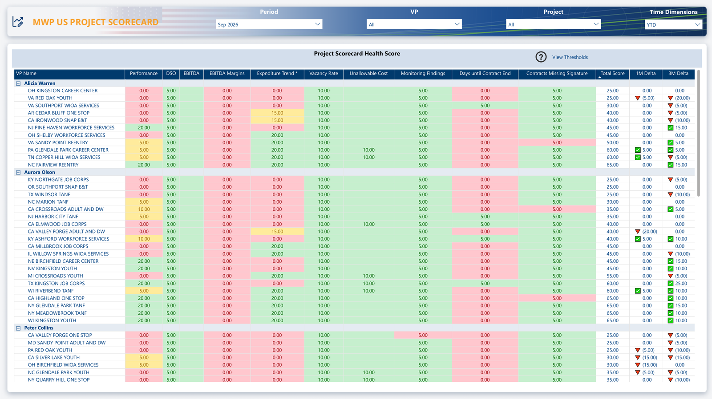
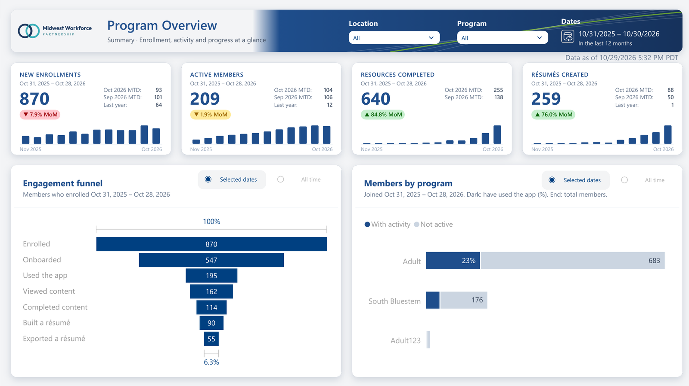
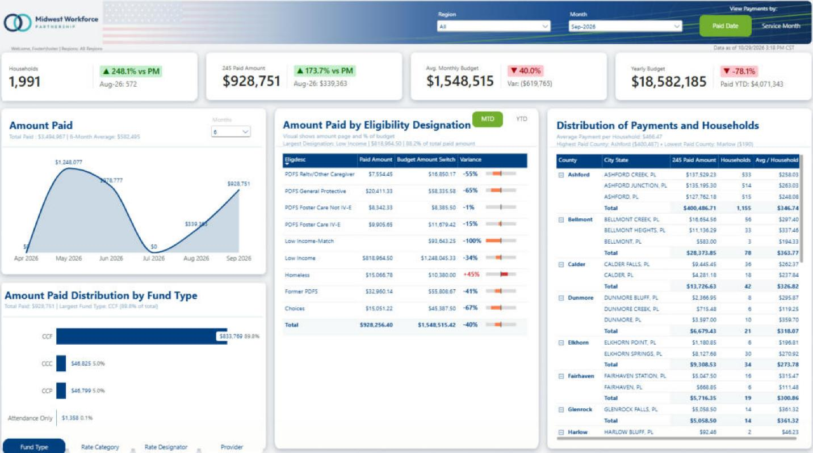

  

  
  
  
  

# Foster BI Services · Power BI Portfolio

**Foster BI Services** builds Power BI reports and semantic models that people trust, and fixes the ones that have grown slow or hard to maintain. This repository is the working proof: production reports rebuilt as samples, plus the DAX, Power Query, Tabular Editor and AI tooling used to build them.

`Power BI` · `DAX` · `DAX UDFs` · `Power Query (M)` · `PBIP / TMDL / PBIR` · `Tabular Editor` · `Semantic modeling` · `Row-level security` · `SVG & HTML visuals in DAX`

| **5** sample reports | **1,167** DAX measures | **215** tables modeled | **21** free toolkit tools |
|:---:|:---:|:---:|:---:|

---

## Services

| | Service | What you get |
|---|---|---|
| 📊 | **Power BI dashboards** | Reports designed around the questions your readers ask, laid out so the key numbers read in seconds: themes in your brand, KPI cards with targets and trends, drill-through detail pages. |
| 🧩 | **Data modeling / DAX** | Star-schema semantic models with measures that are correct, fast and easy for the next developer to follow: date tables, time intelligence, row-level security, measures tested against source figures. |
| 🔍 | **Report audits & optimization** | A review of an existing report and model, with a prioritized list of what to fix and why: best-practice checks, DAX and Power Query performance, documentation your team can keep. |

**→ [Tell us about your project](https://fosterbiservices.com/contact)** · replies within two business days.

---

## Featured reports

Production reports rebuilt as samples. Every record is **synthetic** and the client is rebranded as the fictional **Midwest Workforce Partnership**, while the original design, model and DAX are kept. Download a `.pbix` and open it in Power BI Desktop; no refresh or login is needed.

<table>
  <tr>
    <td width="33%" valign="top">
      
      <b><a href="reports/mwp-us-project-scorecard/">MWP US Project Scorecard</a></b> 
      85 tables · 526 measures · 6 UDFs
    </td>
    <td width="33%" valign="top">
      
      <b><a href="reports/workforce-pathway/">Workforce Pathway</a></b> 
      62 tables · 232 measures · 11 UDFs
    </td>
    <td width="33%" valign="top">
      
      <b><a href="reports/pl-childcare/">PL Childcare</a></b> 
      18 tables · 71 measures · 5 RLS roles
    </td>
  </tr>
</table>

| Report | Highlights |
|---|---|
| [**MWP US Project Scorecard**](reports/mwp-us-project-scorecard/) | Executive risk scorecard over 85 tables and 526 measures. Configurable weighted scoring, and data from five systems (program database, ERP, HRIS, ATS, LMS) in one model. |
| [**Workforce Pathway**](reports/workforce-pathway/) | Product analytics for a career-coaching app. About 40 KPI cards drawn in HTML and SVG by 11 DAX user-defined functions, with hover tooltips. |
| [**DVR LJC Collaboration**](reports/dvr-ljc-collaboration/) | Multi-agency grant reporting. A single `ApplyPeriod` UDF switches 17 measures between monthly and cumulative views, and color-helper UDFs format survey results. |
| [**PL Childcare**](reports/pl-childcare/) | Subsidy payments reconciled across two systems, budget vs actual, and row-level security by region. |
| [**Cedar Hollow IWP**](reports/cedar-hollow-iwp/) | Interim housing operations with cross-system data-quality checks (duplicates, name mismatches, census variance). |
| [**Power BI Résumé**](reports/power-bi-resume/) | The founder's résumé as an interactive report. |

---

## The toolkit behind the work

Everything here is reusable. Clients get the same patterns, scripts and checks that built these reports.

| Folder | What's inside |
|---|---|
| [`dax/`](dax/) | A versioned **DAX UDF library** for time intelligence, classic measure templates (YTD, PY, MoM, YoY, MAT…) and patterns: SVG KPI cards and icons, conditional formatting, navigation, security. |
| [`power-query/`](power-query/) | Reusable M functions and patterns for ingestion, cleansing, date logic and transformations. |
| [`tabular-editor/`](tabular-editor/) | C# scripts for model hygiene, bulk measure and calculation-group generation, and documentation. |
| [`ai-skills/`](ai-skills/) | Agent skills that add hard-to-build visuals to **PBIP** projects by editing TMDL and PBIR directly. |
| [`tools/`](tools/) | Python helpers: DAX/HTML generator, Power BI theme generator (with the [Foster BI Services theme](tools/theme-generator/foster-bi-services-theme.json)), PBIP utilities. |
| [`about/`](about/) | Founder résumé and certifications. |

**Free · [SF Power BI Toolkit](https://fosterbiservices.github.io/Power-BI-Toolkit/)**: 21 browser-based tools that help Power BI developers get more from Copilot when their company limits AI tools. Nothing to install, nothing uploaded. ([source](https://github.com/FosterBiServices/Power-BI-Toolkit))

---

## How we work

1. **Clear models.** Star-schema semantic models, developed as **PBIP** (TMDL + PBIR) so every measure, query and visual change can be reviewed in Git.
2. **Tested measures.** Measures checked against figures you already trust, so the numbers hold up in front of leadership.
3. **Reuse over repetition.** DAX user-defined functions, calculation groups and Power Query functions replace copy-pasted logic.
4. **Documentation you can keep.** Tabular Editor and Python automation produce model documentation your team can pick up after handover.

## About the sample data

The sample reports contain no real people, clients, amounts or identifiers. Data was generated to resemble production volumes and distributions, place names were replaced with fictional ones, and vendor systems are named generically (ERP, HRIS, ATS, LMS).

---

  <a href="https://fosterbiservices.com">
    <picture>
      <source media="(prefers-color-scheme: dark)" srcset="assets/brand/foster-bi-logo-services-white.svg">
      
    </picture>
  </a>

  <b>Fostering Better Business Through the Power of Data.</b> 
  Steven Foster, Founder · <a href="mailto:steven@fosterbiservices.com">steven@fosterbiservices.com</a> · <a href="https://fosterbiservices.com">fosterbiservices.com</a> · <a href="https://www.linkedin.com/in/stevengfoster">LinkedIn</a>

© 2026 Foster BI Services. Not affiliated with Microsoft. Power BI and Copilot are trademarks of Microsoft Corporation.

