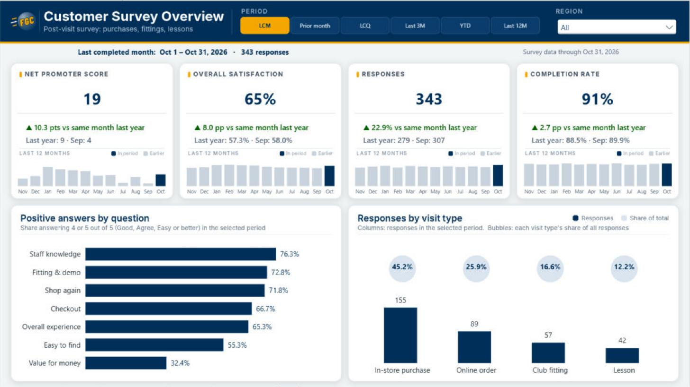
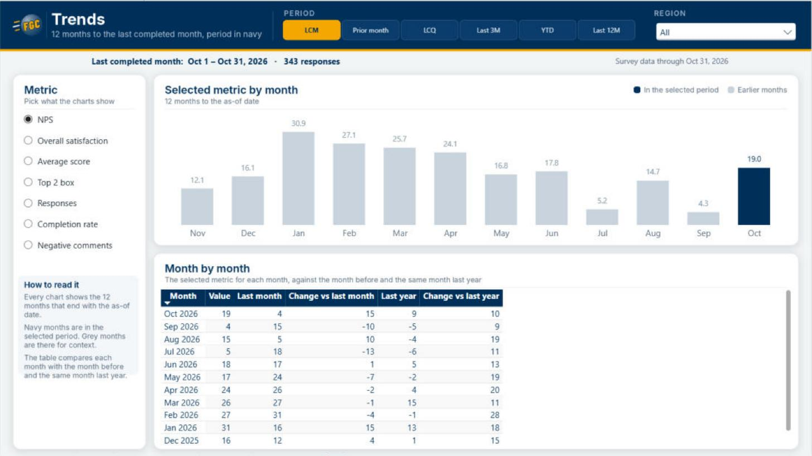
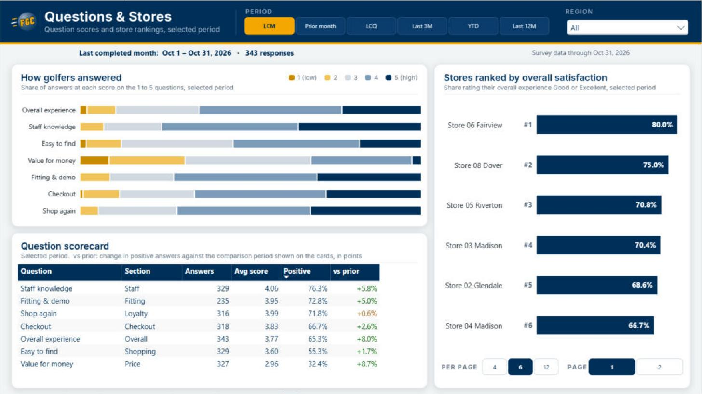
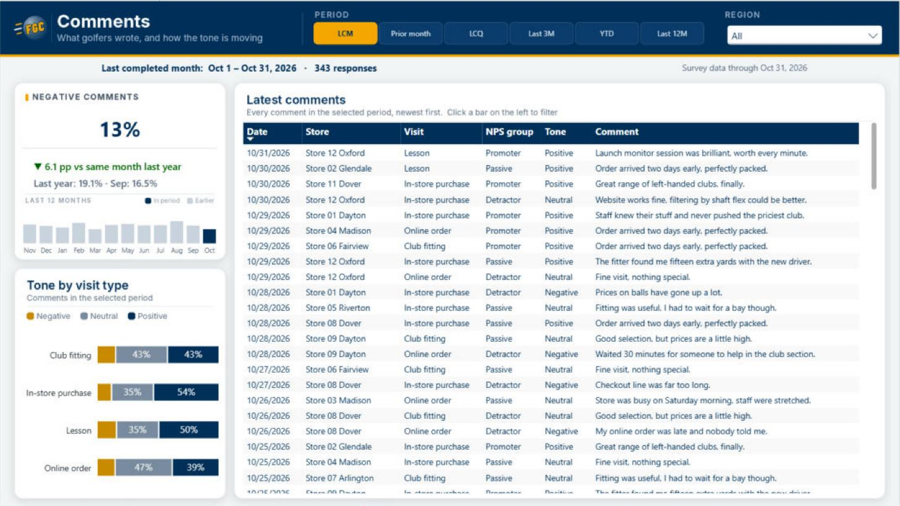

[← All reports](../README.md)

# FGC Customer Survey

A customer-experience report for **Foster Golf Co**, the fictional golf retailer behind the FGC Financials report. It turns post-visit survey answers (after a purchase, club fitting or lesson) into NPS, satisfaction and comment insights, with every KPI shown in context.

**File:** [`FGC Customer Survey.pbip`](./FGC%20Customer%20Survey.pbip) (Power BI project: open it in Power BI Desktop)

## About the data

Everything in this report is **fictional** and **survey data only**. It was generated with the [Sample Data Maker](https://fosterbiservices.github.io/Power-BI-Toolkit/sample-data-maker.html) in the Foster BI Toolkit, using its survey functions (respondents, questions, responses and answers) with a golf question set:

- 7,200 responses from 3,200 golfers, Nov 2024 to Oct 2026, seed 2026;
- 10 questions: overall experience, staff knowledge, easy to find, value for money, fitting & demo, checkout, in stock, shop again, likelihood to recommend (NPS) and a comment box;
- each response carries a hidden satisfaction level that its scores, NPS and comment all lean on, so the numbers agree with each other; some golfers stop part way and most skip the comment;
- the 12 stores are the same as in FGC Financials (same seeded DAX).

The tables are plain DAX calculated tables, so the report needs no data source and never needs refreshing. [`sample-data/golf-survey-functions.tmdl`](./sample-data/golf-survey-functions.tmdl) holds the same tables as seeded DAX user-defined functions, the toolkit's other output.

## Report pages

| Page | What it shows |
|---|---|
| Customer Survey Overview | KPI cards for NPS, overall satisfaction, responses and completion rate, each with its change vs a matched comparison period, two context values, and a 12-month column chart. Positive answers by question and responses by visit type with share-of-total bubbles. |
| Trends | A metric picker, the chosen metric over 12 months, and a month-by-month table vs last month and last year. |
| Questions & Stores | How golfers answered each 1 to 5 question, a question scorecard, and stores ranked by satisfaction with a #rank badge, a page at a time. |
| Comments | Negative-comment KPI with context, tone by visit type and every comment in the selected period. |
| About this Report | Definitions and how the dates work. |

## How the dates work

- The **Period** buttons are the only date control, and the data only ever holds **completed months**. Everything is anchored on the latest one: **LCM** (last completed month, default) is that month, **Prior month** is the one before, **LCQ** (last completed quarter) is the latest quarter with all 3 months in, and **Last 3M**, **YTD** and **Last 12M** end with the last completed month. With data through Oct 31, 2026: LCM = October, Prior month = September, LCQ = Jul–Sep (Q3), Last 3M = Aug–Oct.
- KPI cards, question charts, the store ranking and comments use the **selected period**. The change on each card compares it with the **same months a year earlier** (Last 12M: the 12 months before). The second line adds the period just before it: the month before (LCM, Prior month), the quarter before (LCQ), the previous 3 months (Last 3M) or all of last year (YTD).
- If the period or its comparison has fewer than **100 responses**, the change line turns grey and says so instead of showing a noisy change.
- Every trend chart **always shows 12 months** ending with the as-of month. Months with days in the selected period are **navy**; the rest are **light grey**, for context.

## Techniques worth a look

- **Core visuals only:** new card with reference labels, button slicer, column, bar, 100% stacked bar, line and column combo, table, matrix and slicers. No custom visuals.
- **Figma-style canvas:** each page's header, filter labels, panels, titles and legends are drawn into one background image, so visuals sit cleanly in their panels with their own titles and backgrounds off. The Period buttons are a segmented control, the most common pattern for date ranges on analytics sites.
- **KPI context:** each card's reference labels show the change vs the comparison period (green, amber or red from the theme's good, neutral and bad colors; grey when the sample is too small), then the comparison and context values.
- **One period, many measures:** a `Time Window` calculation group (selected, comparison and context windows) drives every period measure from a disconnected `Report Dates` table (the end of its last completed month is the as-of date, and filters never move it) and a `Period` table that holds each period's names and comparison labels.
- **Highlighted 12-month frame:** a visual filter measure keeps the 12 months (labelled Jan, Feb… and sorted by month start), and a color measure shades the columns in the selected period navy.
- **Chart Patterns** from the [Foster BI Toolkit](https://fosterbiservices.github.io/Power-BI-Toolkit/chart-patterns.html): bubbles over the columns (share of total) and Top N per page (ranked stores with a #rank badge and page buttons).
- **Comparison calculation group** gives the month-by-month matrix its last-month and last-year columns for whichever metric the field parameter picks.

## More pages

| | |
|---|---|
|  |  |
|  | |

## Opening the report

1. Download this folder.
2. Open **`FGC Customer Survey.pbip`** in a recent **Power BI Desktop** (Windows).
3. The tables are calculated in DAX, so they build when the model first opens. No credentials are needed.

---

 <b>Foster BI Services</b> · Power BI consulting · <a href="https://fosterbiservices.com">fosterbiservices.com</a> · <a href="https://fosterbiservices.com/contact">Start a project</a> · <a href="../../README.md">Portfolio home</a>
