[← All reports](../README.md)

# FGC Financial Performance

A financial performance report for **Foster Golf Co**, a fictional golf retailer with 12 stores, an e-commerce site and 40 commercial accounts (clubs, resorts, courses and corporate buyers). It covers the P&L, balance sheet, cash flow, trends and forecast, but it is built as a **decision-making tool, not an accounting tool**: every page says what happened, why it happened, what could go wrong next and what to do about it.

**File:** [`FGC Financial Performance.pbip`](./FGC%20Financial%20Performance.pbip) (Power BI project: open it in Power BI Desktop) · **PDF of every page:** [`FGC Financial Performance.pdf`](./FGC%20Financial%20Performance.pdf)

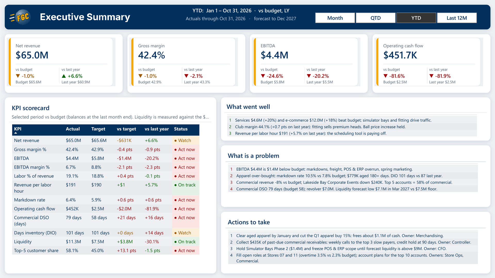

## The story in the data (YTD to October 2026)

| | Actual | vs budget | vs last year | Why |
|---|---:|---:|---:|---|
| Net revenue | $65.0M | -1.0% | +6.6% | Services (+20%) and e-commerce (+18%) beat budget; commercial is 8% behind after one of its largest accounts cut back by about two thirds from June 2026. |
| Gross margin | 42.4% | -0.4 pts | -0.9 pts | Apparel was over-bought: markdowns of 10.5% vs 7.8% budget and an obsolescence reserve. Clubs (fitting mix) and the ball price increase held up. |
| EBITDA | $4.4M | -24.6% | -20.2% | Markdowns, freight, the POS & ERP overrun and spring marketing. |
| Operating cash flow | $0.5M | -$2.0M | -81.9% | $2.0M more inventory and commercial DSO up to 79 days. |
| Liquidity | $11.3M | | | Cash plus the undrawn revolver. The forecast low is **$7.1M in March 2027, below the $7.5M lender floor**. |

Full-year outlook: revenue $77.0M (budget $78.0M), EBITDA $5.0M (budget $6.7M). FY2027 forecast revenue $83.4M.

## How it answers the five questions

| Question | Where the report answers it |
|---|---|
| **1. Can I understand the business in five minutes?** | The Executive Summary: four headline KPIs, a 12-line RAG scorecard (on track, watch, act now) and three written lists: what went well, what is a problem and the actions to take. Every number in those sentences is a measure, so the text updates with the data and the period buttons. |
| **2. Does it explain the drivers behind results?** | Waterfalls that break the variance to budget into its drivers: revenue (volume, mix, price, markdowns), EBITDA (sales, markdowns, product cost, freight and obsolescence, labor, marketing, technology, occupancy) and cash (net income to closing cash). A product profitability heat map, store labor heat map, and Pareto charts for customers and products. |
| **3. Does it identify risks and opportunities?** | Risks & Early Warnings: a risk register where each risk has an indicator, a threshold, a live status and a response with an owner, a heat map (impact x likelihood, with likelihood driven by the indicator today) and early-warning trend lines. Capital projects are scored on budget, timing and payback. |
| **4. Does it include a forecast?** | Rolling forecast to December 2027 on every trend (gold dashed lines), full-year outlook vs budget, next-year forecast, year-end cash and the 6-month liquidity outlook against the lender floor. |
| **5. Does it tell me what actions to take?** | "Actions to take" on the summary (each with an amount and an owner), and a response with an owner for every risk in the register. |

## Report pages

| Page | What it shows |
|---|---|
| Executive Summary | Headline KPI cards, the KPI scorecard with RAG status, what went well, what is a problem and actions to take. |
| Trends & Forecast | Full-year outlook, next-year and year-end cash cards; trend charts for net revenue, gross margin %, EBITDA and cash & liquidity: actual, budget and forecast from Jan 2025 to Dec 2027. |
| Income Statement | The P&L in $K with actual, budget, variance, last year and full-year outlook; the EBITDA variance waterfall; margins by month vs budget. |
| Revenue & Margin Drivers | Revenue variance waterfall (volume, mix, price, markdowns), revenue by channel with share bubbles, product margin by category, product profitability heat map (margin % by month) and markdown rate. |
| Customers & Products | Commercial revenue, top-5 concentration, services and e-commerce cards; revenue Pareto for commercial accounts, margin Pareto for product lines, and ranked accounts a page at a time. |
| Labor & Stores | Labor % of revenue, revenue per labor hour, overtime and labor cost; stores compared on a metric you pick; store labor heat map; productivity and overtime over 24 months. |
| Working Capital & Balance Sheet | DSO, DIO, DPO and cash conversion cycle cards; the balance sheet in $K; working capital days with forecast; receivables aging for the top accounts; inventory and aged stock by category. |
| Cash Flow & Liquidity | Cash bridge from opening to closing cash, the cash flow statement vs budget and last year, liquidity actual and forecast vs the $7.5M floor. |
| Capital Projects | CapEx spend and outlook; project scorecard (forecast at completion, over budget %, months late, payback, RAG); cumulative CapEx vs budget; forecast at completion vs approved budget. |
| Risks & Early Warnings | Risk heat map, risk register and early-warning trends for the three red risks. |
| About this Report | How to read the report, definitions and where the data comes from. |

The **Period** buttons (Month, QTD, YTD, Last 12M) set the window on every page. Each window ends with the last month of actuals (October 31, 2026); balances are at that month end.

## Foster BI Toolkit tools used

Everything that a [Foster BI Toolkit](https://fosterbiservices.github.io/Power-BI-Toolkit/) page can make was made with it, and its output is kept in this project.

| Tool | What it made | Where it is |
|---|---|---|
| [Sample Data Maker](https://fosterbiservices.github.io/Power-BI-Toolkit/sample-data-maker.html) | The data. The toolkit's engine (seeded random numbers, word lists for store cities and account names) runs unchanged in Node, and a golf-finance generator builds the three statements on top of it. | [`sample-data/`](./sample-data/) |
| [Date Table Generator](https://fosterbiservices.github.io/Power-BI-Toolkit/date-table-generator.html) | The `Date` table: calendar 2023 to 2027, fiscal year from January, US holidays, marked as the date table. | `build/generated/date-table-generator.tmdl` |
| [Theme Builder](https://fosterbiservices.github.io/Power-BI-Toolkit/theme-builder.html) | The report theme: navy and gold palette, good / neutral / bad colors used for every RAG status, transparent visuals, no gridlines. | [`assets/FosterGolfCoFinancials.theme.json`](./assets/FosterGolfCoFinancials.theme.json) |
| [Layout Designer](https://fosterbiservices.github.io/Power-BI-Toolkit/layout-designer.html) | A grid layout for each of the 11 pages: the page backgrounds (header band, logo, title and panels), the exact position of every visual, and wireframes. | [`assets/backgrounds/`](./assets/backgrounds/), `build/layout_positions.json`, [`docs/layout/`](./docs/layout/) |
| [KPI Visualizer](https://fosterbiservices.github.io/Power-BI-Toolkit/kpi-visualizer.html) | 24 SVG KPI cards ("card with comparison columns"): value, vs budget (or floor / limit) and vs last year, each with a status arrow and color. | `build/generated/kpi-visualizer-cards.tmdl` |
| [Chart Patterns](https://fosterbiservices.github.io/Power-BI-Toolkit/chart-patterns.html) | Bubbles over columns (revenue by channel with share of total), labels above bars (product margin by category) and Top N per page (ranked accounts with #rank badges and page buttons). | `build/generated/chart-patterns-*.tmdl`, [`docs/toolkit/`](./docs/toolkit/) |
| [Field Parameter Builder](https://fosterbiservices.github.io/Power-BI-Toolkit/field-parameter-builder.html) | `Store Metric`: compare stores by net revenue, gross margin %, EBITDA, labor %, revenue per labor hour, overtime % or markdown rate. | `build/generated/field-parameter-store-metric.tmdl` |
| [RLS Role Generator](https://fosterbiservices.github.io/Power-BI-Toolkit/rls-role-generator.html) | Six roles: one per store region and a Commercial Team role that sees only commercial accounts. | `build/generated/rls-roles.tmdl` |
| [Power Query Writer](https://fosterbiservices.github.io/Power-BI-Toolkit/power-query-writer.html) | The shape of every import query (one decode step, one `Table.FromRows`, one type step), checked by the page, and the shared `fxApplyTypes` type-map function the queries call. | `build/power_query_writer_reply.txt`, `build/generated/power-query-writer-fxApplyTypes.tmdl`, [`docs/toolkit/`](./docs/toolkit/) |
| [Measure Describer](https://fosterbiservices.github.io/Power-BI-Toolkit/measure-describer.html) | Descriptions for the 19 Chart Patterns helper measures that didn't have one (every other measure was written with its description). | `build/measure_describer_reply.txt`, `build/generated/measure-describer-descriptions.dax` |
| [Model Linter](https://fosterbiservices.github.io/Power-BI-Toolkit/model-linter.html) | The best-practice review: 286 findings at the first run, 66 now, all of them deliberate. | [`docs/model-linter-findings.md`](./docs/model-linter-findings.md) |
| [Model Documenter](https://fosterbiservices.github.io/Power-BI-Toolkit/model-documenter.html) | Developer documentation of the model and report: tables, columns, every measure with its DAX and description, relationships, roles, report pages and which visuals use what. | [`docs/model-documentation.html`](./docs/model-documentation.html) |

The page layouts, KPI cards and Chart Patterns visuals were then assembled into PBIR files with the scripts in [`build/`](./build/), using the visual templates from this portfolio's [`ai-skills`](../../ai-skills/) folder for the Chart Patterns charts.

## About the data

Everything in this report is **fictional**. [`sample-data/generate.js`](./sample-data/generate.js) builds it with the Sample Data Maker engine (copied unchanged into `sample-data/vendor/`, seed 2026); the 12 stores come from the same seeded store list as the [FGC Customer Survey](../fgc-customer-survey/).

- **Scope:** actuals January 2023 to October 2026, budgets for FY2024 to FY2026, and a rolling forecast November 2026 to December 2027, monthly.
- **Tables:** sales by store, product and customer (60,696 rows), labor by store and department, the general ledger (P&L and balance sheet accounts), cash flow, receivables aging, inventory by product, capital projects and their monthly spend.
- **It ties:** the P&L agrees with the sales and labor detail, the balance sheet balances every month in every scenario (the generator stops if it doesn't), cash flow explains the change in cash, and the revolver draws and repays to keep cash between $2.5M and $4.0M.
- **It has a story:** apparel over-buying and markdowns, a ball price increase, a premium club mix from fitting, rangefinder cost increases, simulator bays and lessons driving services, e-commerce growth, one large commercial account cutting back by about two thirds from June 2026, three slow-paying accounts, overtime at two stores, a scheduling tool that lifted productivity, a POS & ERP project over budget, and an obsolescence reserve in the autumn of 2026.

The rows are embedded in each Power Query query as compressed text, so the report needs **no data source and no credentials**. The CSV files in [`sample-data/csv/`](./sample-data/csv/) are the same data for anyone who wants to look at it outside Power BI.

## Techniques worth a look

- **Three statements that tie** in one star schema: a `Scenario` dimension (Actual, Budget, Forecast) on every fact table, semi-additive balances (last month end in the window), and layout tables that turn general-ledger accounts into P&L, balance sheet and cash flow lines with subtotals.
- **One period control:** a disconnected `Period` table sets the window start and end for every measure; each measure family follows one pattern (Period, Period Budget, Period PY, vs Budget, vs PY, FY Outlook, forecast lines).
- **Variance bridges as waterfalls:** volume / mix / price / markdowns for revenue, and EBITDA and cash bridges from helper tables of driver steps.
- **Written insights from measures:** "what went well", "what is a problem" and "actions to take" are DAX text measures, so the amounts in the sentences are always current.
- **RAG everywhere from one place:** the scorecard, risk register and project scorecard use status measures with the theme's good, neutral and bad colors.
- **Risk heat map driven by indicators:** each risk's likelihood comes from its key risk indicator against its amber and red thresholds, not from a static score.
- **Continuous date axes** on the trend charts with actual (navy), budget (grey dashed) and forecast (gold dashed) lines.
- **Core visuals only.** No custom visuals.

## More pages

| | |
|---|---|
| 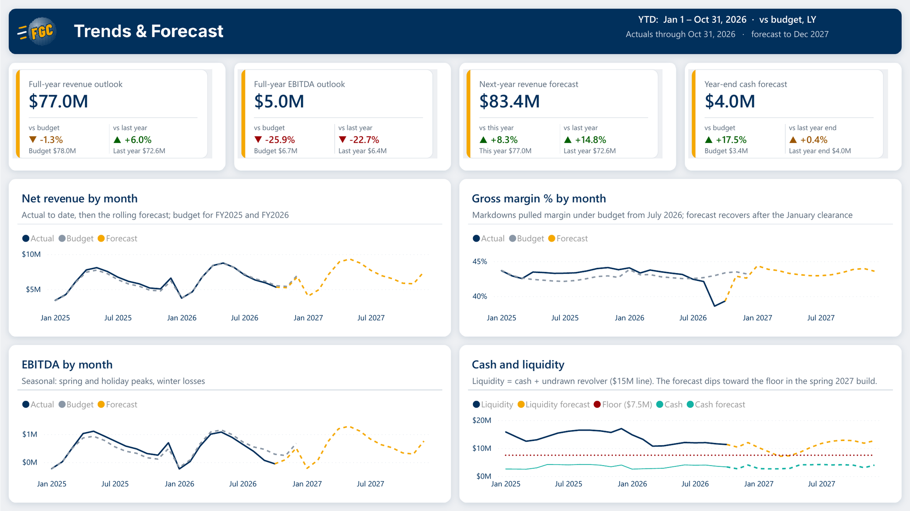 | 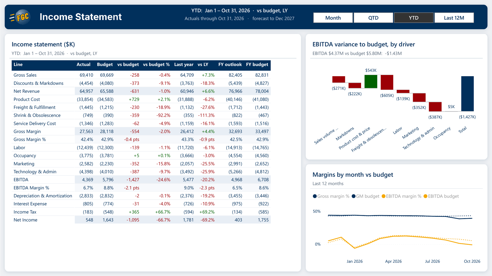 |
| 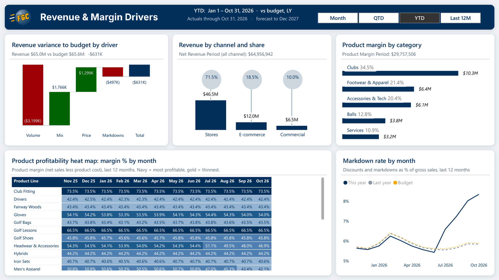 | 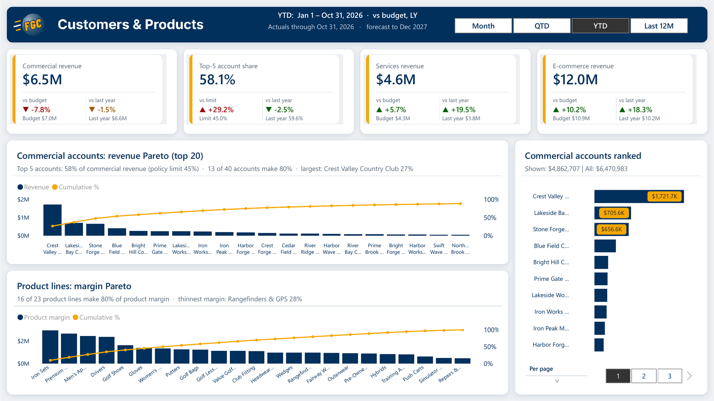 |
| 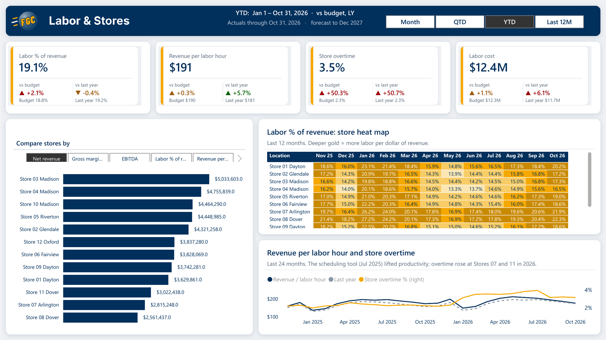 | 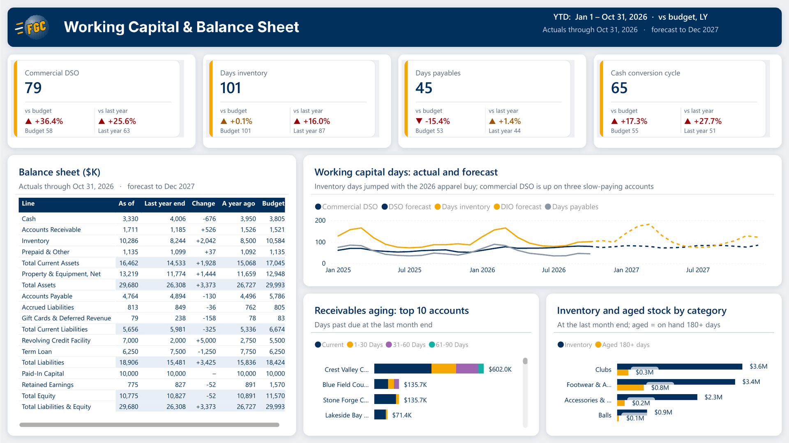 |
| 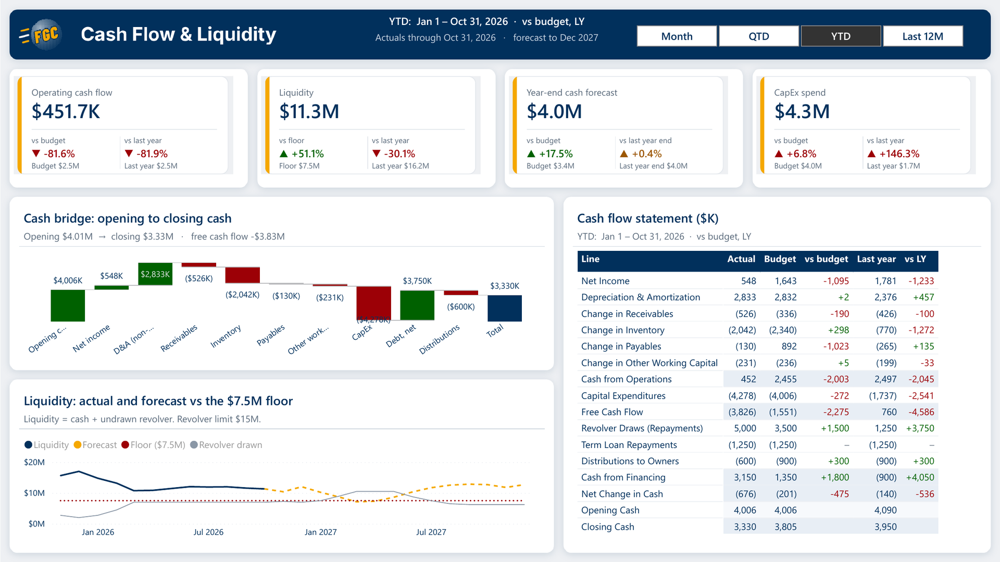 | 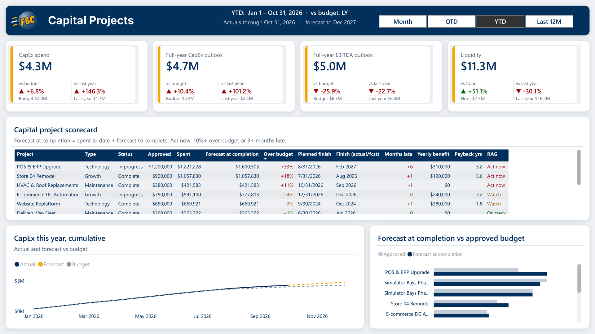 |
| 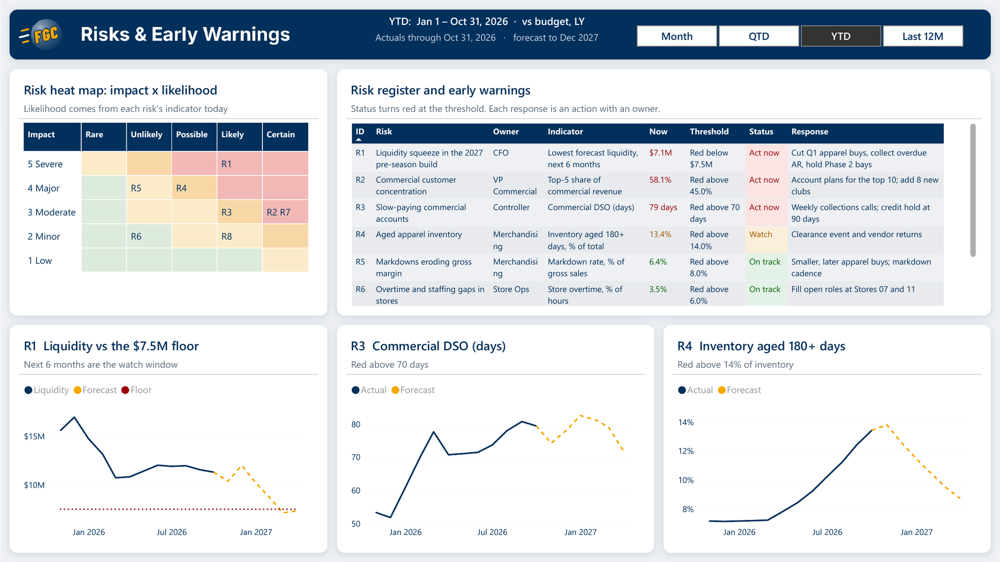 | 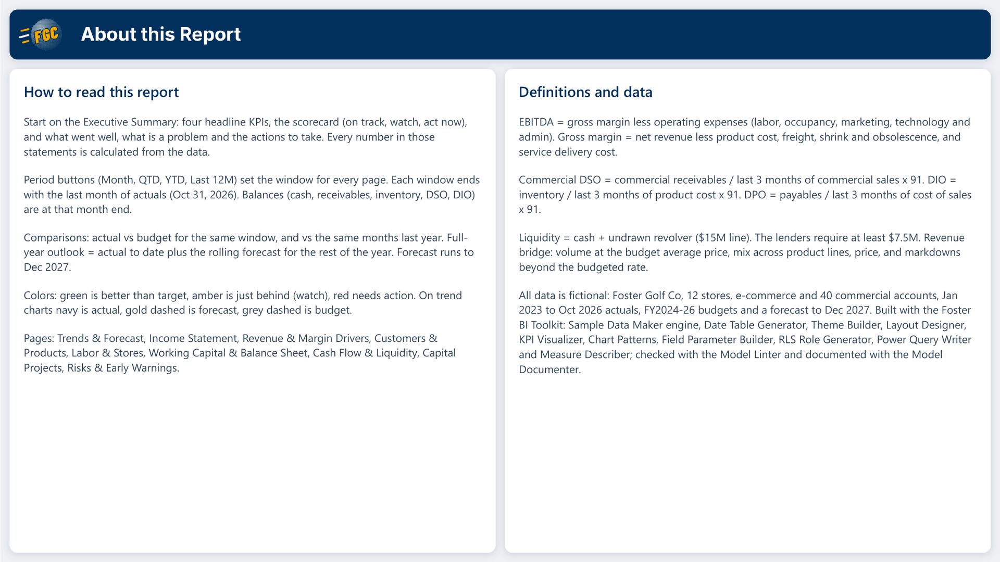 |

## Opening the report

1. Download this folder.
2. Open **`FGC Financial Performance.pbip`** in a recent **Power BI Desktop** (Windows).
3. Select **Refresh** once: the data is embedded in the queries, so no credentials are needed.

## Rebuilding it

```
node sample-data/generate.js                                                    # data -> sample-data/csv
python3 build/build_model.py "FGC Financial Performance.SemanticModel"          # TMDL model
python3 build/build_report.py "FGC Financial Performance.Report" ../../ai-skills # PBIR report
python3 build/tidy_model.py "FGC Financial Performance.SemanticModel" "FGC Financial Performance.Report"
python3 build/check_refs.py                                                     # every field a visual uses exists
```

---

<sub> <b>Foster BI Services</b> · Power BI consulting · <a href="https://fosterbiservices.com">fosterbiservices.com</a> · <a href="https://fosterbiservices.com/contact">Start a project</a> · <a href="../../README.md">Portfolio home</a></sub>
